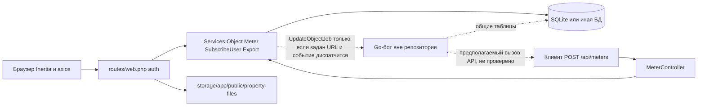

# Архитектура

## Стек и форма приложения

Монолит Laravel 12.20.0 (`composer.lock`) с интерфейсом Inertia.js 2 и React 19. Сборка — Vite 6 и Tailwind CSS 4. Отдельного SPA-бэкенда нет: страницы отдают Inertia-ответы, а списки подписчиков и счётчиков на странице настроек объекта ходят в те же web-маршруты через axios и получают JSON-ресурсы.

Точка входа HTTP — `public/index.php`. Конфигурация приложения — `bootstrap/app.php`:

- web-маршруты: `routes/web.php` (подключает `routes/auth.php` и `routes/settings.php`);
- команды: `routes/console.php`;
- health: `GET /up`;
- дополнительная группа без middleware: префикс `api`, файл `routes/api/api.php`.

Провайдеры: `AppServiceProvider` (пустой) и `EventServiceProvider` (`bootstrap/providers.php`).

К web-группе добавлены `HandleAppearance`, `HandleInertiaRequests`, `AddLinkHeadersForPreloadedAssets`. Cookie `appearance` и `sidebar_state` не шифруются.

## Каталоги

| Путь | Ответственность |
| --- | --- |
| `app/Http/Controllers/Auth`, `Settings` | Каркас входа, регистрации, профиля |
| `app/Http/Controllers/v1/Object` | Объекты, счётчики, файлы, показания, финансы |
| `app/Http/Controllers/v1/Meter` | JSON-приём показаний и фото |
| `app/Http/Controllers/v1/SubscribeUser` | JSON CRUD подписчиков |
| `app/Http/Requests` | Валидация. `BaseRequest::authorize()` всегда `true` |
| `app/Services/Object` | Сценарии объектов, счётчиков, файлов, финансов и сборка страниц Inertia |
| `app/Services/Object/Data` | Типизированные данные страниц. В JSON уходят через `toArray()` |
| `app/Services/Meter` | Запись, правка, удаление показаний и синхронизация `object_properties.value` |
| `app/Services/SubscribeUser` | Подписчик и слот `telegram_users` |
| `app/Services/Export` | XLSX через PhpSpreadsheet |
| `app/Models/Object`, `SubscribeUser`, `TelegramUser` | Eloquent |
| `app/DTO` | Объекты Spatie Laravel Data |
| `app/Entities` | DTO сериализации объекта в JSON для Go API |
| `app/Events`, `app/Subscribers`, `app/Jobs/Object` | Неиспользуемый исходящий HTTP в Go |
| `app/Casts/MonthlyNotificationSchedule.php` | Формат расписания напоминаний |
| `app/Console/Commands/ResetApplicationCommand.php` | `php artisan app:reset` |
| `resources/js/pages` | Страницы Inertia |
| `resources/js/lib/notification-schedule.ts` | Сборка даты напоминания на клиенте |
| `database/migrations` | Схема, включая таблицы, которые пишет бот |

`app/Http/Resources/Object/ObjectCreateResource.php` нигде не вызывается.

## Потоки запросов

### Страница дашборда

`GET /dashboard` → `ObjectController::dashboard` → `ObjectPageService::dashboardObjects` → Inertia `dashboard`.

`POST /objects` → `ObjectController::create` → `ObjectService::create` → редирект на карточку. Имя фиксировано: `Новый объект`, `order = 1`, `user_id` текущего пользователя.

### Карточка и настройки

`GET /objects/{object}` → `ObjectController::show` → `ObjectPageService::show`. Сервис грузит подписчиков, счётчики и `latestReading`, считает финансы и `ReadingSubmissionStatusService::forObject`. Контроллер только вызывает `Inertia::render`.

`GET /objects/{object}/edit` → `ObjectController::edit` → `ObjectPageService::edit`. Сервис вызывает `SubscribeUserService::backfillTelegramUsers` для подписчиков без слота Telegram и собирает `ObjectEditData`.

`PUT /objects/{object}` — Inertia-форма: имя, описание, `notification_date`. Сохранение модели само удаляет `reading_reminder_logs` этого объекта, если расписание изменилось (`ObjectModel::booted`).

### Подписчики и счётчики со страницы настроек

Фронтенд (`resources/js/pages/object/edit.tsx`) вызывает axios с `Accept: application/json`:

- `POST/PUT/DELETE /objects/{object}/subscribers[...]` → `SubscribeUserController` → `SubscribeUserService` → `SubscribeUserGetResource` (обёртка Laravel `{ data: ... }`, фронтенд читает `response.data.data`).
- `POST/PUT/DELETE /objects/{object}/properties[...]` → `ObjectPropertyController` → `ObjectPropertyService` → `ObjectPropertyGetResource` либо `204` на удаление.

Удаление подписчика и счётчика не проверяет, что id принадлежит `{object}` из URL. Сервис ищет запись по первичному ключу.

### Показания, файлы, финансы

Страницы `object/property-readings` и `object/finances` используют Inertia-формы (`router.post` / `useForm`), не axios.

Показания панели идут в `PropertyReadingController`, который проверяет принадлежность счётчика объекту, затем в `PropertyReadingService`. Тот же сервис вызывает `MeterController` для API.

Файлы панели и фото из API пишет `ObjectPropertyFileService`: оба пути кладут файл в `property-files/{id счётчика}` на диске `public`. `store` создаёт вложение счётчика. `storeForReading` сначала удаляет прежние файлы этого показания и записывает новый с `property_reading_id`. У модели файла при `deleting` файл удаляется с диска. Ошибку записи панель показывает формой, API отдаёт исключение сервиса.

Финансы: `ObjectFinanceController` вызывает `ObjectFinanceEntryService`. Сервис создаёт и удаляет `object_finance_entries` и группирует их по `year-month`.

Экспорт: `ExportPeriodRequest` → `PropertyReadingsExportService` или `ObjectFinancesExportService` → `XlsxExporter`. Итоги считает `FinancePeriodTotalsService` (доход, расход, маржа).

### Приём от внешнего клиента

`POST /api/meters/` → валидация `id` (exists `object_properties`) и `value` → `PropertyReadingService::record` с `recorded_at = now()` → `{ status, reading_id }`.

`POST /api/meters/{readingId}/photo` → файл изображения до 10 МБ → замена предыдущего фото показания → `{ status, file_id }`.

## Схема компонентов

## Очередь, события, планировщик

Единственная прикладная задача: `App\Jobs\Object\UpdateObjectJob`. Она сериализует `ObjectEntity` и делает `POST` на `config('services.go_api.object_post_url')`. Ошибки HTTP ловятся и пишутся в лог, исключение наружу не бросается, повторов внутри задачи нет. `composer run dev` запускает `queue:listen --tries=1`.

Цепочка: `AfterUpdateObjectEvent` → `ObjectUpdateEventSubscriber` → `JobObjectUpdateService` → `dispatch`. Подписчик сразу выходит, если URL пустой. Диспатча события в репозитории нет, поэтому при обычном сохранении объекта задача не ставится.

`routes/console.php` содержит только команду `inspire`. Расписания Laravel (`Schedule`) в коде нет. Напоминания в Telegram этим приложением не отправляются.

Команда `app:reset` делает `migrate:fresh`, по флагу `--seed-telegram` запускает `TelegramUserSeeder`, чистит `storage` каталог `property-files` и кэши.

## Решения, уже зафиксированные в коде

- Общая база с ботом — основной способ обмена. HTTP-синхронизация объекта в Go оставлена и явно помечена устаревшей.
- Показание — отдельная строка истории. `object_properties.value` — денормализованное последнее значение. Его пересчитывает `PropertyReadingService` после создания, правки и удаления.
- Статус «сдано в этом месяце» — наличие хотя бы одной записи `property_readings` с `recorded_at` внутри текущего месяца. Частичные показания и несколько показаний за месяц не различаются.
- Ключ регистрации нельзя менять после `telegram_id !== null`.
- Имя подписчика нормализуется: `trim` и срез ведущего `@`.
- Расписание напоминаний в UI — день месяца и время. Год и месяц в строке берутся из текущего значения или из «сейчас» (`resources/js/lib/notification-schedule.ts`). Бизнес-смысл поля — ежемесячное правило, не разовая дата.
- Экспорт финансов сравнивает даты как `year * 372 + month * 31 + day`, без календарной арифметики SQL.
